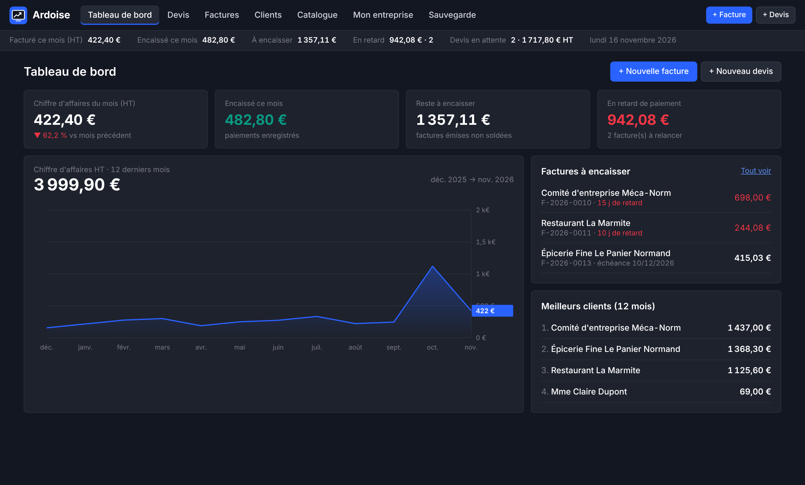

<p align="center"></p>

# Ardoise — Devis & factures des commerces de proximité

Logiciel de devis et de factures **100 % local** : pas de serveur, pas d'abonnement, pas d'IA, aucun coût de fonctionnement.
Il s'ouvre dans le navigateur (Chrome, Edge, Firefox), **fonctionne sans Internet**, et les données restent sur l'ordinateur du commerçant.
Les factures sont produites au **format Factur-X (EN 16931)** demandé par la réforme de la facture électronique.

Pensé pour les commerces qui facturent des professionnels ou des particuliers : cidreries et producteurs, fleuristes, boucheries, épiceries fines, traiteurs…



## Pour l'utiliser ou l'installer chez un client

👉 Un seul fichier suffit : **`dist/Ardoise.html`**, environ 1,5 Mo, avec tout dedans.

1. Copier `Ardoise.html` sur l'ordinateur du client, par exemple dans `Documents/Ardoise/`.
2. L'ouvrir avec Chrome ou Edge, puis créer un raccourci sur le bureau.
3. Remplir **Mon entreprise** : nom, adresse, SIRET, n° de TVA, IBAN, logo.
4. Saisir le **Catalogue** et les **Clients**, avec le SIREN des professionnels.
5. Montrer la **Sauvegarde** hebdomadaire sur clé USB.

> Les données sont liées au navigateur : il faut toujours ouvrir Ardoise avec le même navigateur, depuis le même emplacement. Pour changer d'ordinateur : *Sauvegarde* → télécharger, puis *Restaurer* sur le nouveau poste.
> **Mise à jour** : il suffit de remplacer `Ardoise.html` par la nouvelle version, au même endroit. Les données sont conservées.

Pour démarcher et vendre, le kit commercial est dans [`marketing/`](marketing/) : plaquette, guide client, bon de commande et argumentaire.

## Site en ligne (Vercel)

Le dépôt se déploie tel quel sur Vercel, sans build (Framework Preset : *Other*) :

- `/` : la landing page (`index.html`). Vos coordonnées se modifient dans le bloc `CONTACT`, en bas du fichier.
- `/app.html` : le logiciel ; `/app.html?demo=1` l'ouvre avec l'exemple de démonstration.
- `images/photos/` : photos d'illustration des métiers, créées par IA pour Ardoise (scènes fictives, sans marque ni personne réelle), utilisables librement sur le site et les supports commerciaux.
- `vercel.json` empêche l'indexation par les moteurs de recherche (à retirer pour le lancement public) ; `.vercelignore` exclut l'argumentaire de vente et les outils.

## Fonctionnalités

### Ce qui différencie Ardoise
- **« Ce que vous pouvez vraiment dépenser »** : encaissements du mois, moins la TVA à reverser, moins la part à mettre de côté (taux micro-entreprise ou pourcentage libre). Alerte à l'approche du plafond micro-entreprise ou du seuil de franchise de TVA.
- **Profil de paiement de chaque client** (délai moyen, retards, alerte « demandez un acompte ») et **prévision des encaissements** à 30 jours, corrigée du retard habituel de chaque client.
- **Bons de livraison signés au doigt** sur téléphone ou tablette, puis **facture récapitulative du mois en un clic**.
- **Précommandes** (Noël, fêtes, mariages) avec acompte, **liste de préparation du jour** imprimable, puis facture au retrait, acompte déduit.
- **Marges** : coût d'achat par article, marge sur chaque facture, **clients les plus rentables**.
- **Hausse de tarifs en 1 clic**, avec arrondi et courrier d'information aux clients professionnels.
- **Partage du PDF** sur WhatsApp, par SMS ou par mail depuis le téléphone.
- **Score « Prêt pour la facture électronique »** : ce qu'il reste à faire, point par point.
- **Application installable** sur téléphone, tablette et ordinateur, qui **fonctionne sans réseau** (marché, tournée, cave).

### Le reste

- **Tableau de bord** : chiffre d'affaires, encaissements, reste dû, retards, courbe sur 12 mois, meilleurs clients.
- **Devis** : suivi (envoyé, accepté, refusé, expiré) et **transformation en facture en un clic**.
- **Factures** : brouillon modifiable, puis validation avec un **numéro définitif, continu et chronologique**. Une facture validée ne se modifie plus : les corrections passent par un **avoir**.
- **PDF professionnel** avec le logo, téléchargé directement, sur plusieurs pages si nécessaire.
- **Facture électronique Factur-X** : chaque facture ou avoir validé est un PDF/A-3 qui contient le XML officiel (CII, profil EN 16931). Le XML seul peut aussi être exporté.
- **Paiements** partiels ou complets, **relances** en 3 niveaux.
- **Catalogue** avec prix HT ou TTC, taux de 20 %, 10 %, 5,5 %, 2,1 % et 0 %, remises, quantités décimales (prix au kilo).
- **Mentions légales** ajoutées automatiquement : SIRET, TVA, pénalités, indemnité de 40 €, art. 293 B (micro-entreprise), nature de l'opération, SIREN du client, date et adresse de livraison, option TVA sur les débits.
- **Exports pour le comptable** au format CSV, lisibles dans Excel : journal des ventes avec la TVA par taux, encaissements, clients.
- **Sauvegarde et restauration**, avec un rappel si la dernière sauvegarde date de plus de 7 jours.
- **Sauvegarde automatique dans Google Drive** (version en ligne) : connexion Google, accès limité aux seuls fichiers d'Ardoise (`drive.file`), un fichier par jour, restauration en un clic. Mise en service : [`docs/google-drive.md`](docs/google-drive.md).
- **Exemple de démonstration** (une cidrerie), pour les présentations.
- **Licences** : sans clé, mode démonstration (PDF filigranés « DÉMONSTRATION », pas de Factur-X) ; avec la clé du client (signée, liée à son SIREN), tout est débloqué. Les clés se créent dans l'**espace administrateur** `admin.html`, avec un compte par associé. Mode d'emploi : [`docs/licences.md`](docs/licences.md).

## Facture électronique : ce qui est vérifié

Le XML généré est contrôlé avec les règles officielles, toutes fournies dans la bibliothèque Python `factur-x` :

| Contrôle | Résultat |
|---|---|
| Schéma XSD Factur-X 1.09 (EN 16931) | ✔ sans erreur |
| Schématron EN 16931 (règles métier européennes) | ✔ 0 erreur, 0 avertissement |
| Schématron **BR-FR** (règles françaises de la réforme) | ✔ 0 erreur, 0 avertissement |
| XML intégré au PDF, métadonnées XMP PDF/A-3, profil de couleur, polices intégrées | ✔ |

Cas testés : prix HT, prix TTC avec remise et quantités au kilo, micro-entreprise sans TVA (client particulier), avoir, prestations de services avec TVA sur les débits et adresse de livraison, facture de plusieurs pages.

Pour relancer les contrôles après une modification :

```bash
pip install factur-x saxonche
```

```bash
node outils/generer-echantillons.js
```

```bash
python3 outils/valider-facturx.py
```

> Le contrôle PDF/A complet avec veraPDF, le validateur de référence, n'a pas pu être lancé dans l'environnement de développement. Avant la première vente, faites passer une facture dans un validateur en ligne gratuit (par exemple celui du FNFE-MPE) ou dans l'outil de test de la plateforme agréée retenue.

## Réforme de la facture électronique

- **1er septembre 2026** : toutes les entreprises doivent pouvoir **recevoir** des factures électroniques.
- **1er septembre 2027** : les PME, TPE et micro-entreprises doivent **émettre** leurs factures aux professionnels au format électronique via une **plateforme agréée**, et transmettre leurs données de vente (e-reporting).

Ardoise produit des factures au bon format. **Il n'est pas une plateforme agréée** : le commerçant dépose ses PDF Factur-X sur la plateforme qu'il a choisie.

## Sécurité

Aucune base de données centrale : les données restent chez le commerçant (navigateur et son propre Google Drive). Le logiciel est protégé contre l'injection de code (échappement, nettoyage de toutes les données chargées, CSP stricte), les fichiers de sauvegarde piégés et l'injection de formules dans les exports. Détails, tests et **liste des choses à verrouiller sur vos comptes** (GitHub, Vercel, Google) : [`docs/securite.md`](docs/securite.md).

## À savoir

- Ardoise est un logiciel de **facturation**, pas un **logiciel de caisse** : les ventes au comptoir passent par une caisse certifiée.
- Les taux de TVA indiqués dans l'aide sont indicatifs et doivent être validés par le comptable du client.
- Les factures doivent être conservées **10 ans**.

## Développement

```
index.html            landing page (page d'accueil du site)
app.html              le logiciel Ardoise
css/style.css         thème sombre (les documents imprimés restent sur fond blanc)
js/app.js             application : données, écrans, calculs
js/facturx.js         génération XML CII EN 16931 et PDF/A-3 (Factur-X)
js/vendor/            pdf-lib, fontkit, polices et profil couleur (voir LICENSES.txt)
build.js              assemble le tout dans dist/Ardoise.html
outils/               génération d'échantillons et validation Factur-X
marketing/            plaquette, guide client, bon de commande, argumentaire
```

- Aucune dépendance à installer pour utiliser le logiciel.
- Après une modification, régénérer le fichier unique avec `node build.js`.
- Pour **renommer** le logiciel : modifier la ligne `APP` en haut de `js/app.js`, le logo dans `index.html` et les fichiers de `marketing/`.
- Données stockées dans le `localStorage` du navigateur, sous la clé `ardoise_v1`.
